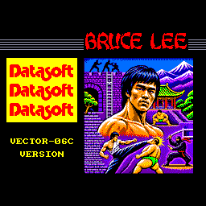
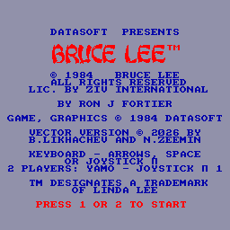
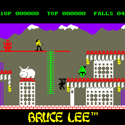
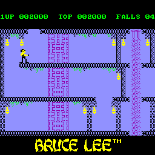
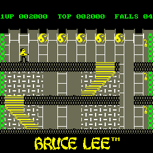
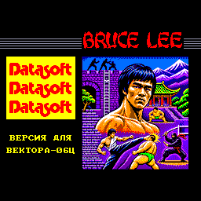
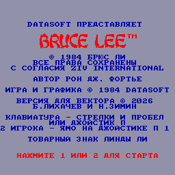

# Bruce Lee — порт на Вектор-06Ц

**Bruce Lee** (Datasoft 1984, версия для ZX Spectrum — L.T. Software / U.S. Gold) на ванильном **Векторе-06Ц**:
i8080 3 МГц, 64 КБ, без Z80-переходника и без квазидиска. За основу взят дизассемблер Никиты Зимина
([skoolkit-game-revs/brucelee-zx](https://github.com/nzeemin/skoolkit-game-revs/tree/master/brucelee-zx)) и
лента BUGFIX. Логика переведена на i8080 через JS-модель и сверена с оригиналом ZX проход в проход
(10 сценариев, ~150 тысяч проходов главного цикла: все 20 комнат, финал и новый круг, двое игроков,
Ямо за второго игрока, без звука, джойстик Sinclair, конец игры) — и в отдельной сборке, и в боевом образе.
Внешность и звук — от версии **Amstrad CPC**: спрайты персонажей, палитры комнат, мелодии и эффекты (на ВИ53),
ближний бой Ниндзя и Ямо и стрельба колдуна; ход игры — ZX. Есть **русская версия** (отдельный образ).

  

 

 

Карта всех 20 экранов — [docs/brucelee_map.png](docs/brucelee_map.png).

## Готовые образы

Образ памяти **с адреса 0x0000** (64 КБ): на MiSTer (ядро Vector-06C) открывается через меню ядра как `.C00`
(или файлом `.mgl`), в эмуляторах (Emu80, vector06js) — как `.r0m`.

| Файл | Что это |
|---|---|
| [`rom/BruceLee-v06c.c00`](rom/BruceLee-v06c.c00), [`.r0m`](rom/BruceLee-v06c.r0m), [`.mgl`](rom/BruceLee-v06c.mgl) | английская версия |
| [`rom/BruceLee-v06c-ru.c00`](rom/BruceLee-v06c-ru.c00), [`.r0m`](rom/BruceLee-v06c-ru.r0m), [`.mgl`](rom/BruceLee-v06c-ru.mgl) | русская версия: тексты, заставка, шапка «И1 … РЕКОРД … ЖИЗНИ» |
| [`rom/BruceLee-v06c.rom`](rom/BruceLee-v06c.rom), [`rom/BruceLee-v06c-ru.rom`](rom/BruceLee-v06c-ru.rom) | без заставки, с адреса 0x0100: для эмуляторов как `.rom`, для CP/M — переименовать в `.COM` |

## Управление

Заставка — любая клавиша или огонь джойстика. На титуле: **1**, пробел или огонь — один игрок, **2** — двое.

| действие | клавиатура | джойстик «П» |
|---|---|---|
| влево, вправо | ← → | влево, вправо |
| вверх (прыжок, лестница), вниз (присесть) | ↑ ↓ | вверх, вниз |
| удар | пробел | огонь |
| пауза / дальше | ВК | |
| из паузы — в титул | АР2 | |
| звук вкл/выкл | УС | |

Один игрок — Брюс: клавиатура и оба джойстика «П». Двое — Брюс: клавиатура и джойстик «П» Б, Ямо — джойстик «П» А.

Скрытый старт: на титуле **Ф1 + Ф3** вместе — игра на одного, жизни не убывают.

## Что по-другому, чем на ZX

- **Цвет без клэша.** На ZX спрайт перекрашивает клетку 8×8 в свои чернила; здесь цвет попиксельный, палитры
  комнат и персонажи — как у CPC.
- **Экран без тени.** Каждый байт экрана пишется один раз итоговым значением (тайл + спрайты), перерисовываются
  только изменившиеся персонажи — без мерцания. Вода (водопады) сдвигает точки прямо на экране, как и на ZX.
- **Звук** — мелодии и эффекты CPC на ВИ53; как у CPC, игра на время звука не останавливается.
- **Колдун** (комната 18) — по рисунку CPC, стреляет как у CPC (5 направлений), огонь не стирает окружение; после
  подбора фонарика — звук фонарика, взрыв и колдун исчезает по точкам; фонарик мигает.
- **Финал** — мелодия титула, Брюс прыгает на месте, сокровища мерцают, потом поздравление и легенда.
- **Заставка** — своя картина в цветах CPC; показывается один раз при включении, потом игра распаковывается (ZX0).

## Сборка

Нужны Node.js, Python 3 с Pillow, [sjasmplus](https://github.com/z00m128/sjasmplus) (`tools/sjasmplus`) и
лента BUGFIX `orig/bugfix/BruceLee(fixed).tap` (в репозиторий не входит): из неё снимается эталонный образ
памяти, данные игры и заставка.

```sh
./build.sh          # build/vec/brucelee.bin (+ _ru), rom/BruceLee-v06c*.r0m и .c00 — английская и русская
./build.sh check    # и проверки: логика и боевой образ по эталонам ZX, комнаты, колдун, финал, ввод, пауза, экраны
```

Как устроено и проверено — [docs/PLAN.md](docs/PLAN.md), [docs/JOURNAL.md](docs/JOURNAL.md), раскладка памяти —
[docs/VEC_LAYOUT.md](docs/VEC_LAYOUT.md).
